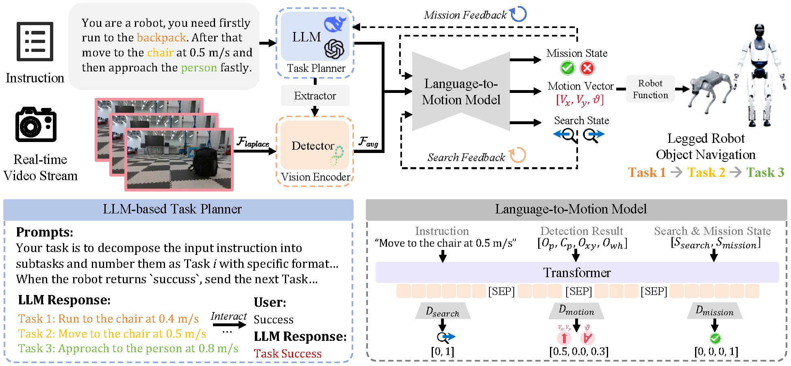
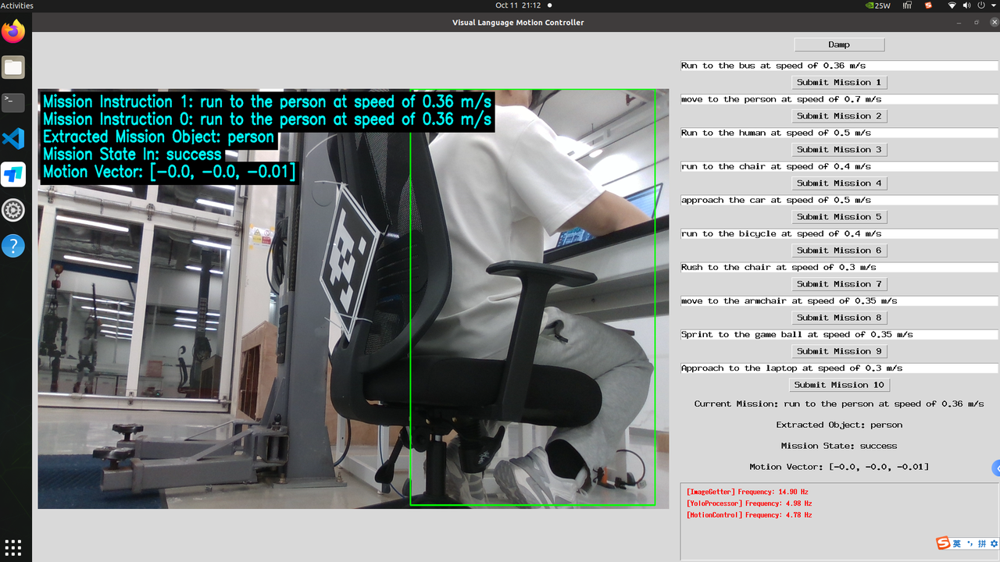

<div align="center">
 
# LOVON: Legged Open Vocabulary Object Navigator</a>

[](https://daojiepeng.github.io/LOVON/)
[](https://arxiv.org/abs/2507.06747)
[](https://www.bilibili.com/video/BV1xh3ezJEJn/?share_source=copy_web&vd_source=49611dfae89f996cc7959e0fb4a4dcd3)

<p align="center">
  
</p>

</div>


## 💡 Introduction


LOVON, a novel framework that integrates large language models (LLMs) for hierarchical task planning with open-vocabulary visual detection models, tailored for effective long-range object navigation in dynamic, unstructured environments.

<p align="center">
  
</p>


## TODO List

We are currently working on organizing the code for the LOVON project, and it will be released progressively. The upcoming tasks include:

- [x] **More Details About Dataset Generation**: Provide additional information on dataset generation.

- [x] **Training Details**: Provide detailed information about the model training process, including configurations, hyperparameters, and training procedures.
- [x] **Deployment Details**: Provide guides about the deployment of the system on robots like Unitree Go2/H1-2/B2 using Jetson Orin. 
- [ ] **Deployment with LLM**: Provide guides about the deployment of the system on robots utilizing LLM for long-horizon tasks.


## Preface

Welcome to LOVON, a framework for training and deploying models that bridge natural language instructions with robotic motion and object perception. This guide walks you through dataset generation, model inference with pretrained examples, and training the core components: the Language-to-Motion Model (L2MM) and the Instruction Object Extractor (IOE). Finally, you will be able to deploy the trained policy on robots like Unitree Go2/H1-2/B2.

## <a id="section0"></a> 0. Prepare the Environment


```bash

# 1. Create a virtual environment
conda create -n lovon_env python=3.8 -y
# Activate the environment
conda activate lovon_env

# 2. Install PyTorch (Choose based on your GPU configuration)
# For CPU-only
pip install torch>=1.10.0
# For GPU, install manually according to your CUDA version (e.g., CUDA 11.7)
pip install torch==1.13.1+cu117 torchvision==0.14.1+cu117 torchaudio==0.13.1 --extra-index-url https://download.pytorch.org/whl/cu117

# 3. Install other dependencies
pip install -r requirements.txt

```
> Note: Check out here to find the PyTorch version suitable for your device - [PyTorch Install Guide](https://pytorch.org/get-started/locally/)


## 1. Dataset Generation 

Navigate to the project's `scripts` directory and run the data generation script. Use the `--num_samples` flag to specify the number of samples you want to generate.

> Note: To ensure high-quality data templates, we utilize Large Language Models (LLMs) for optimization—this includes refining template structure, relevance, and flexibility. The finalized, improved templates are stored in the `scripts/templates/` directory; these optimized templates then serve as the foundation for generating data that is both broadly generalizable and practically applicable.

```bash
cd ~/LOVON/scripts/
python dataset_generation.py --num_samples 1000000
```
### Output Details
The generated data is saved in the **current directory** (i.e., ~/LOVON/scripts/) with the parent folder name:
* `generated_vlm_dataset_n{num_samples}_cxn025`

(where {num_samples} is replaced by the value you set, e.g., 1000000).


**Quick-View Samples**: Small sample files are provided to inspect the data format without opening the full dataset. They are saved alongside the main dataset and named:

* `vision_language_motion_pair_format_n{num_samples}_examples.csv`
* `vision_language_motion_pair_format_n{num_samples}.json`


**Full Dataset Structure**:
* Unsplitted data:
`scripts/generated_vlm_dataset_n{num_samples}_cxn025/vision_language_motion_pair_format_n{num_samples}/`
* Train-test split (8:2 ratio):
`scripts/generated_vlm_dataset_n{num_samples}_cxn025/vision_language_motion_pair_format_n{num_samples}/`

## 2. Try Out the Pretained Models Examples

In the `~/LOVON/models/` directory, there are pretained model examples together with the corresponding APIs. Run the following commands to test them:

**Test Language-to-Motion Model (L2MM)**
```bash
cd ~/LOVON/models/
# try the L2MM
python api_language2motion.py
```
**Test Instruction Object Extractor (IOE)**
```bash
cd ~/LOVON/models/
# try the IOE
python api_object_extraction.py

```
**Expected Outputs**

After running the scripts, you will see predicted outputs similar to these:

```bash
~/LOVON/models$ python api_language2mostion.py
Prediction results:
Motion vector: [0.87, 0.0, -0.38]
Predicted state: searching
Search state: had_searching
~/LOVON/models$ python api_object_extraction.py
Input mission instruction: run to the bicycle at speed of 1.66 m/s
Predicted target object: bicycle
```


## 3. Train the Language-to-Motion Model (L2MM)

Navigate to the scripts directory and run the L2MM training script. Use flags like  `--n_dataset` to specify the source dataset size and other hyperparameters.

### Key Flags Note

* **First run:** Do NOT use --load_tokenizer (the script will automatically build a new tokenizer).
* **Subsequent runs:** Use --load_tokenizer to reuse the existing tokenizer (saves time).

```bash
cd ~/LOVON/scripts/
python language2motion_trainer.py \
    --n_dataset 1000000 \
    --d_model 128 \
    --nhead 4 \
    --batch_size 256 \
    --epochs 30 \
    --learning_rate 5e-5 \
    --beta 5 \
    --load_tokenizer
```
> Important: The tokenizer is critical for model performance. If you plan to use a pretrained L2MM, ensure you use the exact same tokenizer that was used during its training.

### Training Outputs

**Checkpoints & Configs:**
Trained model files are saved in the scripts/ directory (same as the training script) with names like:
* `model_language2motion_xxx.pth`: Best-performing model checkpoint (during training).
* `model_language2motion_xxx.json`: Training configuration details (hyperparameters, dataset info, etc.).

**Custom Paths:** Use these flags to override default paths:
* `--output_dir xxx`: Specify a custom directory to save checkpoints/configs.
* `--tokenizer_dir xxx`: Use a tokenizer from a custom directory (instead of the default).


### Training Progress
Training metrics (loss values) are printed to the terminal in real time. Example output:

```bash
...
Saved best model at Epoch 1
Epoch 1/30:
Train - Motion Loss: 0.0615, Mission State Loss: 0.8797, Search State Loss: 0.3686, Total Loss: 1.5559
Test  - Motion Loss: 0.0382, Mission State Loss: 0.6032, Search State Loss: 0.2632, Total Loss: 1.0574
----------------------------------------
Saved best model at Epoch 2
Epoch 2/30:
Train - Motion Loss: 0.0386, Mission State Loss: 0.5405, Search State Loss: 0.2319, Total Loss: 0.9653
Test  - Motion Loss: 0.0333, Mission State Loss: 0.4846, Search State Loss: 0.2031, Total Loss: 0.8541
----------------------------------------
...
```

## 4. Train the Instruction Object Extractor Model (IOE)

Navigate to the scripts directory and run the IOE training script. Use flags to specify the dataset size, hyperparameters, and tokenizer directory (critical: IOE must use the same tokenizer as L2MM).

```bash
cd ~/LOVON/scripts/

python object_extraction_trainer.py \
    --n_dataset 1000000 \
    --d_model 256 \
    --nhead 4 \
    --batch_size 256 \
    --epochs 30 \
    --learning_rate 5e-5 \
    --tokenizer_dir tokenizer_language2motion_n1000000
```

### Training Outputs

**Checkpoints & Configs**: Trained IOE files are saved in the scripts/ directory with names like:
* `model_object_extraction_xxx.pth`: Best-performing model checkpoint.
* `model_object_extraction_xxx.json`: Training configuration details.
**Custom Paths:** Use these flags to override defaults:
* `--output_dir xxx`: Custom directory for saving checkpoints/configs.
* `--tokenizer_dir xxx`: Path to the tokenizer used for L2MM (required for consistency).

### Training Progress
Training loss metrics are printed to the terminal. Example output:

```bash
...
Saved best model at Epoch 1
Epoch 1/30:
Train Loss: 0.3684
Test  Loss: 0.0105
----------------------------------------
Saved best model at Epoch 2
Epoch 2/30:
Train Loss: 0.0106
Test  Loss: 0.0088
----------------------------------------
...
```

## 5. Depolyment

This section guides you through the deployment process of LOVON on a range of robots, such as Unitree's Go2, H1-2, and B2.

### Prepare the Environments
**Create the Virtual Environment**:
```bash
# 1. Create a virtual environment
conda create -n lovon_env python=3.8 -y
# Activate the environment
conda activate lovon_env
```
**Configure the Jetson Orin**: We depoly LOVON using Jestson Orin. So first follow the [official guide](https://www.jetson-ai-lab.com/initial_setup_jon.html) from NVIDIA to setup your Jetson device. Note that installing pytorch in Jetson platform is a bit different from that in x86 system. You can refer to [this link](https://docs.nvidia.com/deeplearning/frameworks/install-pytorch-jetson-platform/index.html) or [this link](https://forums.developer.nvidia.com/t/pytorch-for-jetson/72048) for guidance.


> Nevertheless, you can have no problem running the deployment code directly on other devices (like your laptop) if you don't have a Jetson device. In that case, connect your device and the robot with the internet cable. 

**Verify Pytorch Installation**: To verify that PyTorch has been installed correctly on your system, launch an interactive Python interpreter from terminal (python command for Python 2.7 or python3 for Python 3.6) and run the following commands:

```bash
import torch
print(torch.__version__)
print('CUDA available: ' + str(torch.cuda.is_available()))
print('cuDNN version: ' + str(torch.backends.cudnn.version()))
a = torch.cuda.FloatTensor(2).zero_()
print('Tensor a = ' + str(a))
b = torch.randn(2).cuda()
print('Tensor b = ' + str(b))
c = a + b
print('Tensor c = ' + str(c))

import torchvision
print(torchvision.__version__)
```

Once you have installed the pytorch successfully, you can follow the same way to install other dependencies as described in [Section 0. Prepare the Environment](#section0)

**Installing Unitree's Python SDK**: Follow the guide below to install the Unitree's python SDK from source. Quick scripts to install are as follows:
```bash
cd ~
sudo apt install python3-pip
git clone https://github.com/unitreerobotics/unitree_sdk2_python.git
cd unitree_sdk2_python
pip3 install -e .
```
If you run into cyclonedds error, try this first:
```
pip install cyclonedds==0.10.2
```
If you still have trouble installing this SDK, go to the [official project - unitree_sdk2_python](https://github.com/unitreerobotics/unitree_sdk2_python) for more references. 


<!-- ```
grep -v 'torch' requirements.txt | pip install -r /dev/stdin
``` -->

### Execute the Depoloyment Code

**Connect the Robot**: Before executing the code, make sure robot and camera are well connected to the Jetson. We use realsense d435i as the default camera and the go2 as default robot configuration. Good news is that we also support robots' inner camera if you don't have a realsense d435i camera and other robot type like H1-2 and B2. They can be chosen by simply using key args like `--robot_type 'b2' --camera_type 'inner'` while executing the code.

**Obtain the YOLO Model**: All the models and apis are already included here except for the object detection model (yolos). You can download `yolo11x.pt` (use as default in the guide) or `yolov8x-worldv2.pt` following this link - [yolo11x](https://github.com/ultralytics/assets/releases/download/v8.3.0/yolo11x.pt)/[yolo-world](https://github.com/ultralytics/assets/releases/download/v8.3.0/yolov8x-worldv2.pt) and put it in the `LOVON/models/yolo-models/` directary. The file structure should like this:
```
.
├── deploy
│   └── lovon_deploy.py
├── LICENSE
├── models
│   ├── api_language2mostion.py
│   ├── api_object_extraction.py
│   ├── model_language2motion_n1000000_d128_h8_l4_f512_msl64_hold_success
│   ├── model_object_extraction_n1000000_d64_h4_l2_f256_msl64_hold_success
│   ├── __pycache__
│   ├── tokenizer_language2motion_n1000000
│   └── yolo-models
│       ├── yolo11x.pt
│       └── yolov8x-worldv2.pt
├── README.md
├── requirements.txt
└── scripts
    ├── dataset_generation.py
    ├── generated_vlm_dataset_n1000000_cxn025
    ├── language2motion_trainer.py
    ├── model_language2motion_n1000000_d128_h8_l4_f512_msl64_hold_success
    ├── model_object_extraction_n1000000_d64_h4_l2_f256_msl64_hold_success
    ├── object_extraction_trainer.py
    ├── templates
    └── tokenizer_language2motion_n1000000

```

**Launch the code**: Navigate to the LOVON project directory and launch the deployment code as follows:

```bash
cd LOVON
python deploy/lovon_deploy.py 
```

We provide a GUI version of LOVON for easy instruction input. After a short while, you will see a UI similar like this:

<p align="center">
  
</p>

There are some instructions ready to be executed by clicking the `Submit Mission x` button. You can also modify them with different target objects and speeds. Have fun with your robot but remember to be careful!

You can also modify the key args using `--xxx xxx`. For example, if you want to change the robot type to be **B2** with its **inner** camera and a Laplacian Variance threshold of **100**, you can launch with the following command:

```bash
cd LOVON
python deploy/lovon_deploy.py --robot_type 'b2' --camera_type 'inner' --threshold 100
```
For reference on additional key argument options, please inspect the source code in [lovon_deploy.py](deploy/lovon_deploy.py).
## Support

If you run into any issues, please open a new GitHub issue. If you do not receive a response within 3 business days, please email Daojie PENG (dpeng108@connect.hkust-gz.edu.cn) to bring the issue to his attention.